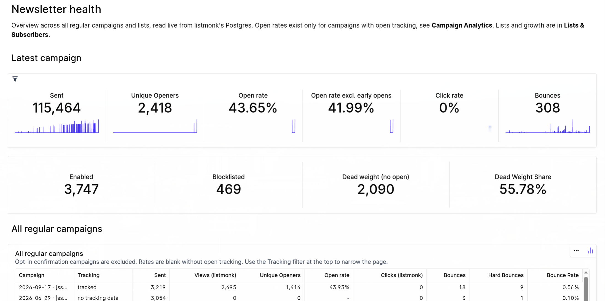
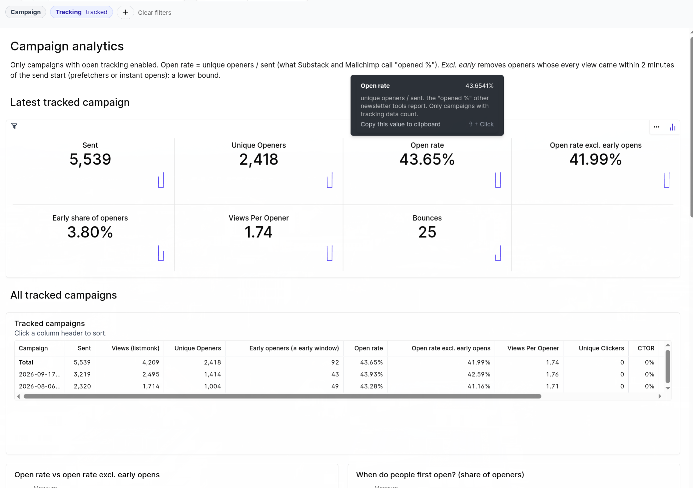
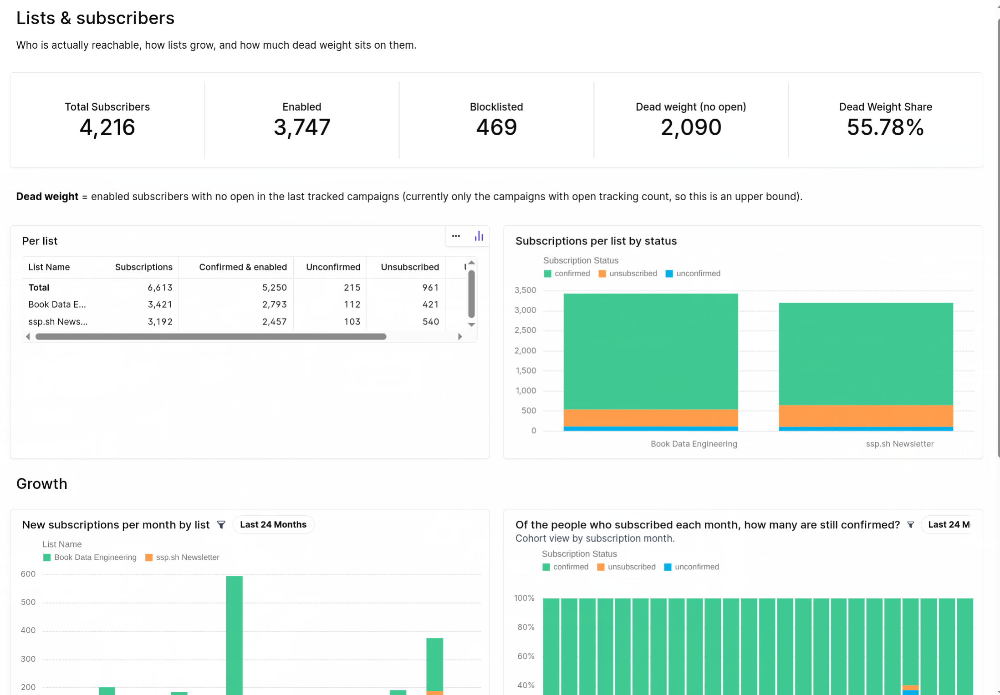
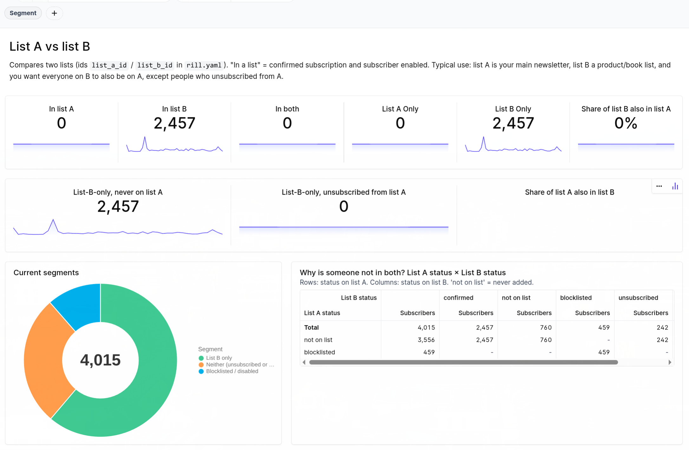
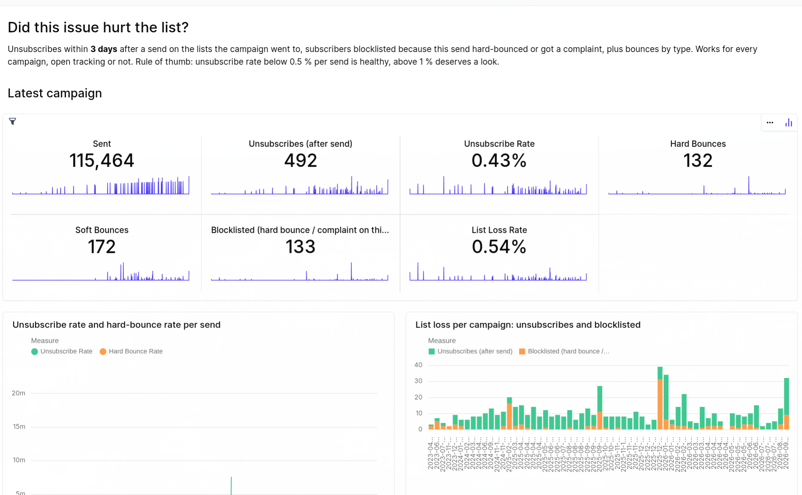

# listmonk-dashboard

Newsletter analytics beyond the default dashboard on [Listmonk](https://listmonk.app), straight from its own Postgres tables copied locally and explored with local dashboards in [Rill](https://docs.rilldata.com) (DuckDB) with an [Evidence](https://docs.evidence.dev) run with DuckDB.

> [!NOTE]
> Evidence connects live to against Postgres, and Rill copies data in local `tmp/` folder.

Listmonk shows you views and clicks. This adds what you actually want to know:

| Dashboard | What it answers |
|---|---|
| **Newsletter Health** | Latest campaign KPIs, all campaigns with listmonk's totals, reconciliation of listmonk's two "views" numbers against raw events |
| **Campaign Analytics** | Unique openers, open rate (= unique openers / sent, the "opened %" other tools report), open rate excluding early (≤ 2 min) opens as a lower bound, views per opener, time to first open per minute/hour, CTOR |
| **Lists & Subscribers** | Reachable subscribers (enabled + confirmed), per-list status, growth per month, dead weight |
| **List Overlap** | Two lists compared: in both, A only, B only, who could be added to A without re-adding opt-outs, evolution per month |
| **Campaign Impact** | Did this send hurt the list? Unsubscribes within 3 days, blocklistings from its hard bounces, bounce types, list-loss rate, for every campaign |

Explores (drill-down) exist for every metrics view as well.

## Screenshots

### Newsletter Health



### Campaign Analytics



### Lists & Subscribers



### List Overlap



### Campaign Impact



## Requirements

- [Rill](https://docs.rilldata.com/get-started/install) ≥ 0.90, `jq`, `curl`, `duckdb` CLI (for the connectivity check)
- Read access to listmonk's Postgres and a read-only listmonk API user
- Optional: [Evidence CLI](https://docs.evidence.dev/cli) for the `evidence/` version

## Setup

```bash
cp .env.example .env          # fill in Postgres + API credentials
make pg-check                 # Postgres reachable via DuckDB's postgres extension?
make fetch                    # listmonk's own numbers via API -> data/*.json (used for reconciliation)
make                          # rill start --pull-env=false, opens http://localhost:9009
```

`rill.yaml` → `env:` holds the non-secret settings:

| key | meaning | default |
|---|---|---|
| `early_min` | minutes after campaign start; openers whose every view falls inside count as "early" | 2 |
| `list_a_id`, `list_b_id` | the two listmonk list ids compared on *List Overlap* | 1, 2 |
| `impact_window_days` | unsubscribes/blocklistings within this many days after a send are attributed to it | 3 |

Postgres models refresh daily at 06:00 UTC (`refresh.cron`, disabled while `rill start` runs locally: use the
refresh button or `make refresh`). Cron `make fetch` daily if you want the API reconciliation numbers current.

## Evidence version

```bash
make ev-connection   # writes evidence/connection.yaml from .env (git-ignored)
make ev              # evidence dev -> http://localhost:3000
```

Same five dashboards as Markdoc pages; `evidence/queries/*.sql` hold the logic in Postgres SQL. Set your two
list ids in `queries/subscriber_segments.sql` and `queries/segment_timeline.sql`.

## Project layout

```
models/pg_*               raw listmonk tables (DuckDB postgres extension, read-only attach, no emails/names loaded)
models/api_*              listmonk API snapshots from data/ (scripts/fetch.sh)
models/sent_campaigns     one row per sent regular campaign (opt-in confirmation campaigns excluded)
models/subscriber_campaign  one row per (campaign, subscriber) that opened, minute-level
models/campaign_summary   per-campaign rates, early vs later openers, first-open buckets, reconciliation columns
models/daily_activity     (campaign, day, type, source, count): API vs raw
models/subscriptions      one row per (subscriber, list) membership
models/list_health        enabled / blocklisted / dead weight snapshot
models/subscriber_segments, segment_timeline   list A vs list B overlap, now and per month
models/unsubscribe_events, bounce_events, campaign_impact   unsubscribes/bounces attributed to campaigns
metrics/*                 metrics views with inline explores
dashboards/*.yaml         the five canvases
scripts/                  fetch.sh (API), pg_check.sh, check.sh (sanity checks), evidence_connection.sh
evidence/                 Evidence project (pages/, queries/)
```

## Privacy

Only `id`, `status` and timestamps are loaded from `subscribers`; no email, name or attributes ever leave
Postgres. Integer subscriber ids are still personal data under GDPR, so keep the dashboards local.

## How the numbers are defined

- **Open rate** = `COUNT(DISTINCT subscriber_id)` in `campaign_views` for the campaign / `sent`. Pixel-based,
  so inflated by Apple Mail Privacy Protection and scanners, undercounted when images are blocked. Compare
  trends, not absolutes.
- **Early openers** = every view within `early_min` minutes of the campaign start. Prefetchers or people on a
  notification; listmonk stores no user agent to tell them apart. *Open rate excl. early* is a lower bound.
- **Listmonk's campaign list "views"** counts every pixel load. Its **Analytics page** counts each subscriber
  once, on their first-open day, plus one group for anonymous views. Both are reproduced.
- **Tracking status**: `tracked` (per-subscriber opens exist), `unique n/a` (views without subscriber id,
  individual tracking off), `no tracking data`. Rates are NULL, not 0 %, when not tracked.
- **Unsubscribe attribution**: most recent campaign sent to that list within `impact_window_days` before the
  unsubscribe. **Blocklisted** = hard bounce or complaint on that campaign and the subscriber is blocklisted now.

## Listmonk quirks found along the way

- The analytics API returns wrong per-campaign numbers when several `id` params are passed at once; `fetch.sh`
  queries one campaign per call.
- Blocklisting on bounce does not touch `subscribers.updated_at`; the bounce table is the reliable trail.
- Opt-in confirmation campaigns (`type = 'optin'`) are excluded everywhere.

## License

MIT
